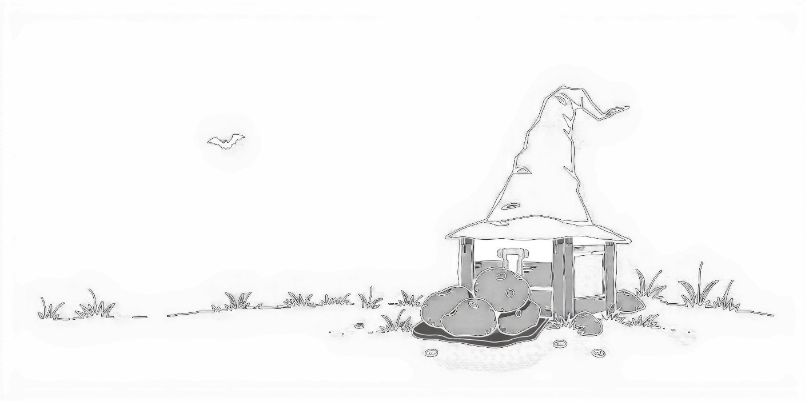

<p align="center">
  
</p>

# rincewind

> [!WARNING]
> This tool is written with AI, the code is partially vetted by a human.
> All commands interacting with a cluster or other system are defined in hats,
> the tool itself does not contain any code that runs against external systems.
> The exception to the rule are interactions with Github,
> for searching and downloading hats.

Config-driven cluster diagnostic TUI.
Views are pulled out of a **hat**: a directory of YAML files.
Each view runs a script,
reads a stream of JSON values from its stdout
and shapes them into a table with jq expressions.
Any command that prints JSON can feed a view —
kubectl, curl, your own pipeline.

```yaml
views:
  - id: argo.apps
    source:
      script: |
        kubectl get applications -A -o json
    rows: .items[]
    key: .metadata.name
    columns:
      - name: NAME
        expr: .metadata.name
      - name: SYNC
        expr: .status.sync.status
        emphasis: { Synced: good, OutOfSync: bad }
    sort:
      - by: SYNC
        rank: [OutOfSync, Synced]
    actions:
      - key: enter                 # drill down: opens a view in a new tab
        name: resources
        open: argo.syncstatus
        args: { app: .metadata.name }
```

Actions come in two kinds, and both open a tab.
`open:` navigates to another view, about the row under the cursor.
`script:` does work — once per **selected** row,
with values derived by jq reaching the script as environment variables,
never templated into it.
A working action collects its parameters,
then shows the exact invocations and asks underneath them:

```
pause  infra
  name=infra
  sh -c
    kubectl patch machineconfigpool "$name" --type merge -p '…'
  machineconfigpool/infra patched
```

You confirm with the command in front of you,
the output lands beside the call that produced it,
and `esc` takes you back to the list untouched.

[docs/hat.md](docs/hat.md) is the complete schema reference;
[example/](example/) is a hat that invents its own data —
no cluster needed, and the place to start when writing your own.

## Use

```
rincewind hats search                  # find repositories of hats on GitHub
rincewind hats install vshn/rincewind-hats
export RINCEWIND_HAT=~/.config/rincewind/vshn-rincewind-hats/albedaran

rincewind                      # TUI, on the hat above
rincewind --hat ./example      # try it without a cluster, no install needed
rincewind check                # validate the hat, and say where it thinks it is
rincewind view nodes.status    # print one view and exit, no TUI
rincewind act nodes.status cordon node-a   # run one of its actions
```

A hat is found with `--hat`, else `$RINCEWIND_HAT`;
with neither given, rincewind lists what is installed rather than guessing.

`hats install` clones into `~/.config/rincewind/`
(or `--dir`, or `$RINCEWIND_HATS_DIR`).
`hats update` fetches, shows the diff, and asks before applying;
`hats list` prints the paths, `hats remove` deletes a clone.
**A hat is shell scripts that run as you, against your cluster** —
the topic search is discovery, not a registry,
so read one before installing it.

`view` prints a table column-aligned, a log verbatim,
and a followed view as it streams;
colour only when stdout is a terminal, cell errors to stderr.
Parameters are `-p name=value`.

`act` runs one of a view's actions without the TUI,
rows named by their key — run it without any to see them, or `--all`:

```
$ rincewind act argo.apps sync wildfly
context: c-appuio-lab-cloudscale-rma-0 · cloudscale

sync  wildfly
  app=wildfly
  sh -c
    argocd app sync "$app"

Sync wildfly (1 row) [y/N]
```

Same order as the TUI — collect, plan, ask, run — and the same engine.
The plan and the question go to stderr, the scripts' output to stdout,
so a redirect catches the results rather than the transcript.
`--yes` skips the question but never the plan;
`-` reads the keys from stdin, which is how it composes:

```
rincewind view argo.apps | awk '$2=="OutOfSync" {print $1}' \
  | rincewind act argo.apps sync - --yes
```

A log is `class: text`: lines verbatim, `/` greps, arrows scroll;
`follow: true` streams them as the script writes them.
Time series are `class: chart`,
drawn as a braille plot with a legend.

**Contexts** say where you are.
A context is a script printing JSON with jq over it;
the labels are shown top right —
`c-appuio-lab-cloudscale-rma-0 · cloudscale` —
and asked for again whenever the view changes,
so what you are about to act on is on screen before you act.
Views that `needs:` a context leave the menu where it is definitively
inactive; a probe that could not run hides nothing,
`H` brings hidden views back, and they still run by name.
`rincewind check` reports each context, its label,
and whether its `tools:` are on `PATH`:

```
$ rincewind check --hat example
example: 8 views ok

  cluster    active    demo-cluster  sh ✓
  cloudy     active    cloudy        sh ✓                    1 view
  elsewhere  inactive                dinsdale ✗ not on PATH  1 view
```

A hat is read by binaries older than itself, so **a key this build does not
know is reported and ignored** rather than refused — otherwise one person
adding a field to a shared hat takes the whole tool away from everyone who has
not upgraded. A hat that cannot afford that says so:

```yaml
rincewind: ">= 0.8"
```

and an older binary then refuses it by name. `rincewind check --strict` turns
the notes back into errors, which is what a hat's own pipeline wants: there an
unknown key is a typo and nothing else.

A reload that fails keeps the rows you had:
the failure is said in full under them,
and the status line marks them `⚠ stale — from <time>`.

In the TUI: `⏎` runs the view under the cursor, `⇥` focuses the output,
`/` filters, `space`/`a` select rows, `r` reloads, `q` quits.
In the output pane the view's own action keys apply —
the box under the table says which.
Drilling down opens a tab: `]`/`[` switch, `esc` or `x` closes one,
and coming back finds the filter, cursor and scroll exactly as they were.
Both panes scroll: `↑↓`, `⇞`/`⇟` by the screenful, `home`/`end` to the ends,
and `<` `>` sideways through wide tables — the column names stay put.

`Y` copies what the output pane is showing, as plain text —
the selection if there is one, otherwise everything the filter left —
via `pbcopy`/`wl-copy`/`xclip`/`xsel` when one is on `PATH`,
plus the terminal's own OSC 52 escape, which is what works over ssh.
The mouse works too: the wheel scrolls, a click moves the cursor,
clicking a menu entry runs it,
and `M` releases the mouse to the terminal for text selection.

## Build

```
make              # lint, test, build
make release      # all four release binaries in dist/, without publishing
```

## Docs

- [docs/hat.md](docs/hat.md) — the hat author's reference:
  the complete schema, field by field
- [docs/architecture.md](docs/architecture.md) — pipeline, stdout contract,
  error philosophy, decisions
- [example/](example/) — a hat that invents its own data;
  read it first when writing a hat of your own

## Licence

Apache 2.0,
the same as its sibling [gandalf](https://github.com/appuio/gandalf).
See [LICENSE](LICENSE).
